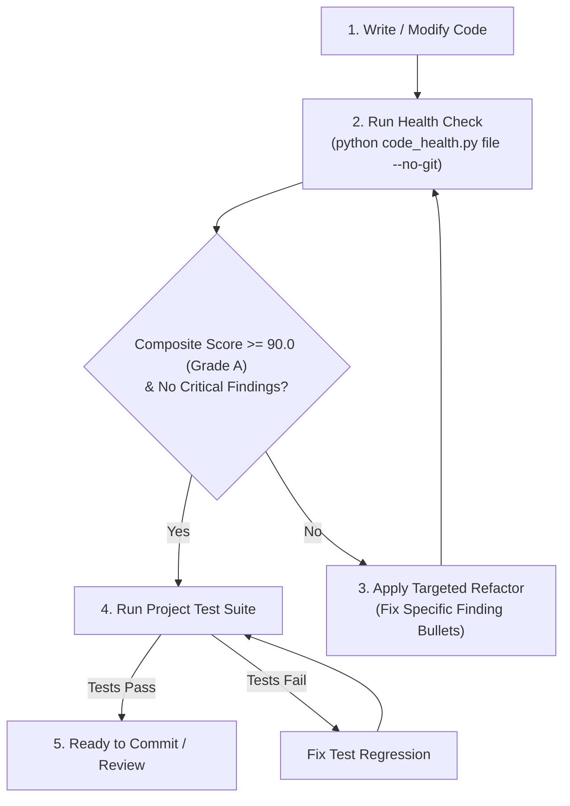

# Deterministic Multi-Language Code Health

Use this skill to inspect, grade, and iteratively refactor **Python**, **Java** (including **Spring Boot**), **JavaScript / JSX** (`.js`, `.jsx`, `.mjs`, `.cjs`), and **TypeScript / TSX** (`.ts`, `.tsx`, `.mts`, `.cts`) code (including **React**, **Next.js**, and **Angular** profiles) against an objective, deterministic 0–100 engineering rubric across five dimensions:
1. **Single Responsibility & Cohesion (SRP) — 30%**
2. **Size & Readability — 25%**
3. **Complexity & Control Flow — 20%**
4. **Clean Code & Maintainability — 15%**
5. **Security & Boundary Hygiene — 10%**

Every deducted point produces an exact line-numbered finding showing what caused the smell and how much it cost. Python analysis runs out of the box with zero external dependencies on Python 3.11+.

---

## When to Use

- **During Feature Implementation:** After drafting a new function, method, component, or class, run the analyzer on your file with `--no-git` to immediately spot size, complexity, or SRP bloat before writing more code.
- **Before Declaring Done:** Ensure any modified or created files achieve **Grade A ($\ge 90.0$)** with zero critical findings before committing or requesting review.
- **During Refactoring:** Run with `--symbol <name>` or `--only-flagged` to isolate and tackle low-scoring units one by one.
- **In Quality Gates:** Use `--fail-under 90.0` (or `95.0` for high-assurance libraries) in CI or verification scripts to enforce engineering standards objectively.

---

## Quick Reference & Commands

The analyzer scripts are bundled inside this skill's `scripts/` folder:

```bash
# 1. Fast inner-loop check on a single modified file (sub-second AST/CST check)
python <path-to-skill>/scripts/code_health.py path/to/file.py --no-git
python <path-to-skill>/scripts/code_health.py path/to/File.java --no-git
python <path-to-skill>/scripts/code_health.py src/services/auth.ts --no-git

# 2. Focus on a specific class, component, or method
python <path-to-skill>/scripts/code_health.py path/to/file.py --symbol MyClass.process_item --no-git
python <path-to-skill>/scripts/code_health.py path/to/File.java --symbol OrderService.processOrder --no-git

# 3. Quality-gate threshold (exits 1 if score < 90.0) and filter clean methods
python <path-to-skill>/scripts/code_health.py src --only-flagged --fail-under 90.0 --no-git
python <path-to-skill>/scripts/code_health.py src --lang typescript --fail-under 90.0 --no-git

# 4. Multi-language repository scan with Git churn analysis
python <path-to-skill>/scripts/code_health.py src tests --format console

# 5. Language or framework profile override
python <path-to-skill>/scripts/code_health.py src --lang java --framework spring-boot --no-git
python <path-to-skill>/scripts/code_health.py src --lang javascript --no-git
python <path-to-skill>/scripts/code_health.py src --lang typescript --framework react --no-git
python <path-to-skill>/scripts/code_health.py src --framework nextjs --no-git
python <path-to-skill>/scripts/code_health.py src --framework angular --no-git

# 6. Export JSON and Markdown scorecards
python <path-to-skill>/scripts/code_health.py src tests --json-out scorecard.json --markdown-out HEALTH.md
```

> [!TIP]
> **Locating the script:**
> - Inside this repository: `python scripts/code_health.py`.
> - From global skills (`~/.gemini/config/skills/code-health`): `python ~/.gemini/config/skills/code-health/scripts/code_health.py`.
> - If copied to project `.agents/skills/code-health`: `python .agents/skills/code-health/scripts/code_health.py`.

---

## Language & Framework Auto-Detection

The analyzer automatically detects language and framework context without requiring manual flags:
- **Language Detection:** Inferred from file extensions:
  - `.py` $\to$ Python (stdlib `ast`, zero dependencies)
  - `.java` $\to$ Java
  - `.js`, `.jsx`, `.mjs`, `.cjs` $\to$ JavaScript (ECMAScript / JSX)
  - `.ts`, `.tsx`, `.mts`, `.cts` $\to$ TypeScript / TSX
- **Spring Boot Framework Detection:** Automatically enabled when:
  1. File source contains `org.springframework` imports or Spring annotations (`@RestController`, `@Service`, `@SpringBootApplication`).
  2. Workspace contains `pom.xml`, `build.gradle`, or `build.gradle.kts` referencing `spring-boot` or `org.springframework`.
- **UI Framework Detection:** Automatically enabled for JS/TS files when:
  - **React**: `.jsx`/`.tsx` JSX syntax, `react` imports, or `react` in `package.json`.
  - **Next.js**: `next` in `package.json`, `next/*` imports, or `'use client'`/`'use server'` directives.
  - **Angular**: `@angular/core` in `package.json` or `@angular/*` imports on TypeScript files.

### CLI Overrides

Override automatic detection when necessary:
- `--lang {auto,python,java,javascript,js,typescript,ts}`: Restrict discovery to a specific language.
- `--framework {auto,spring-boot,react,nextjs,angular,none}`: Force or disable framework rules (e.g., `--framework none` for vanilla Java/JS/TS).

---

## Mandatory Native Parser Gate (Java, JavaScript & TypeScript Analysis)

To guarantee 100% syntactic precision, Java, JavaScript, and TypeScript code health analysis require their respective native Tree-Sitter parsers (`tree-sitter-java`, `tree-sitter-javascript`, `tree-sitter-typescript`). There is **zero heuristic fallback**.

If a required native parser is missing when analyzing Java, JavaScript, or TypeScript code, the CLI halts with **exit code 2** and emits a clear banner:

```text
[WARNING] Native JavaScript AST parser ('tree-sitter-javascript') is not installed.
To analyze JavaScript files, install the native parser dependencies:
  • uv (ephemeral): uv run --with tree-sitter --with tree-sitter-javascript python scripts/code_health.py <paths>
  • uv (project):   uv pip install "tree-sitter>=0.23.0" "tree-sitter-javascript>=0.23.0"
  • pip:            pip install tree-sitter tree-sitter-javascript
```

In JSON mode (`--format json`), the CLI returns:
```json
{
  "status": "missing_native_parser",
  "language": "javascript",
  "missing_packages": ["tree-sitter", "tree-sitter-javascript"],
  "install_commands": {
    "uv_ephemeral": "uv run --with tree-sitter --with tree-sitter-javascript python scripts/code_health.py",
    "uv_project": "uv pip install 'tree-sitter>=0.23.0' 'tree-sitter-javascript>=0.23.0'",
    "pip": "pip install 'py-code-health[javascript]'"
  },
  "message": "[WARNING] Native JavaScript AST parser ('tree-sitter-javascript') is not installed..."
}
```

> [!IMPORTANT]
> **Pure Python files never trigger the native parser warning.** Python analysis uses the standard library `ast` module with zero external dependencies.

---

## Interpreting Scorecards & Grade Scale

The analyzer outputs:
1. **Header Banner:** Overall composite score (0–100), letter grade (`A`–`F`), and the 5 dimension averages.
2. **Files Table:** Per-file breakdown of LOC, Git commits, dimension scores, and composite grade.
3. **Classes Table:** Per-class LOC, method count, field/attribute count, LCOM4 cohesion score, and grade.
4. **Flagged Functions & Methods Table:**
   - Location: `file:lineno`
   - Symbol: `Class.method` or `function_name`
   - Metrics: `LOC`, `CC` (Cyclomatic Complexity), `CogC` (Cognitive Complexity), `Params`, `Nesting`
   - Dimension Scores & Grade
   - **Exact Penalty Reasons:** Bulleted list detailing every deduction, e.g.:
     - `Size: LOC=48 (>25) (-34.5 pts)`
     - `Complexity: cognitive=14 (>8) (-15.0 pts)`
     - `SRP: mixes 3 concerns (filesystem_io, presentation, serialization) (-12.0 pts)`
     - `Clean: missing return type annotation (-10.0 pts)`

### Grade Scale

- **Grade A (90.0 – 100.0):** Healthy, cohesive, clean code. Target for all production code.
  - **High-Assurance Quality Gates (95.0 – 100.0):** For mission-critical libraries, core infrastructure, or strict refactoring runs (`--fail-under 95.0`). Requires zero test smells, strict assertion hygiene, hoisted module imports, and tight LOC limits across all files.
- **Grade B (80.0 – 89.9):** Minor smells or slightly long methods. Easy to polish to Grade A.
- **Grade C (70.0 – 79.9):** Moderate smells (e.g. mixed concerns, high cognitive complexity).
- **Grade D / F (< 70.0):** Architectural violations, God classes, deep nesting, prototype pollution, XSS sinks, SQL injection, or dynamic code execution risks.

---

## The Iterative Refactoring Loop

When writing or refactoring code, follow this 5-step cycle:



1. **Check Baseline:** Run `python <path-to-skill>/scripts/code_health.py path/to/file --no-git`.
2. **Isolate Worst Offenders:** Look at the Flagged Functions table. If composite is `< 90.0`, pick the lowest scoring function, component, or class.
3. **Apply Targeted Refactor:** Read the specific finding bullet points and apply the refactoring patterns from the playbooks below.
4. **Re-check Score:** Re-run the analyzer. Verify that the score increased and findings were resolved.
5. **Verify Tests:** Run the project test suite (e.g. `pytest`, `mvn test`, `npm test` / `vitest`) to guarantee the refactoring preserved behavior.

---

## References & Playbooks

- [Scoring Rubric Reference](references/scoring-rubric.md): Detailed mathematical models, metric thresholds, and penalty weights across Python, Java/Spring Boot, JavaScript/JSX, TypeScript/TSX, and UI frameworks.
- [Python Refactoring Playbook](references/python-playbook.md): Before/after refactoring patterns for SRP concern separation, function/class size, cognitive complexity, and assertion hygiene.
- [Spring Boot Refactoring Playbook](references/java-spring-playbook.md): Before/after refactoring patterns for `@Autowired`, controller layering, `@Transactional`, and SQL parameterization.
