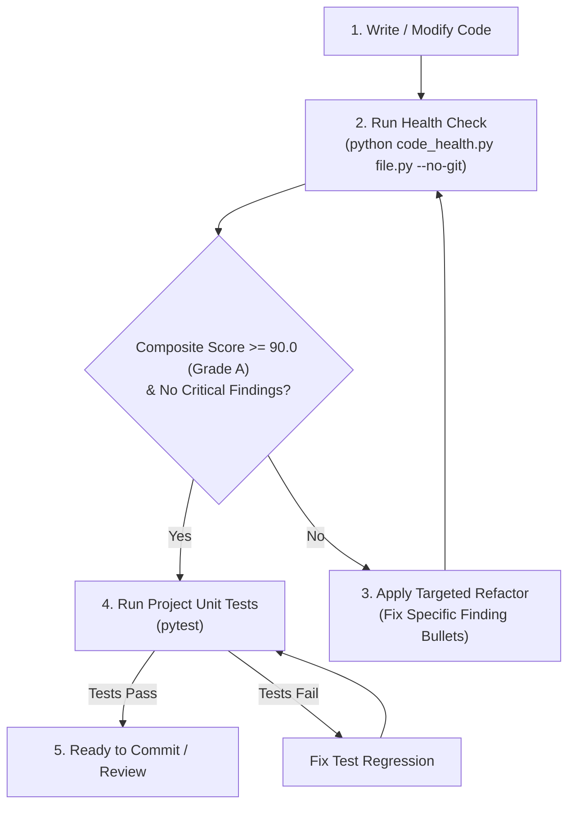

# Deterministic Python Code Health

Use this skill to inspect, grade, and iteratively refactor Python code against an objective, deterministic 0–100 engineering rubric across five dimensions:
1. **Single Responsibility & Cohesion (SRP) — 30%**
2. **Size & Readability — 25%**
3. **Complexity & Control Flow — 20%**
4. **Clean Code & Maintainability — 15%**
5. **Security & Boundary Hygiene — 10%**

The analyzer is completely self-contained in standard Python 3.11+ with **zero external dependencies**. Every deducted point produces an exact line-numbered finding showing what caused the smell and how much it cost.

---

## Quick Reference & Commands

The analyzer scripts are bundled inside this skill's `scripts/` folder. In any project, locate the script and invoke it with Python:

```bash
# 1. Fast inner-loop check on a single modified file (sub-second AST-only)
python <path-to-skill>/scripts/code_health.py path/to/file.py --no-git

# 2. Focus on a specific class or method
python <path-to-skill>/scripts/code_health.py path/to/file.py --symbol MyClass.process_item --no-git

# 3. Quality-gate threshold (exits 1 if score < 90.0) and filter clean methods
python <path-to-skill>/scripts/code_health.py path/to/file.py --only-flagged --fail-under 90.0 --no-git

# 4. Multi-file or full repository scan with Git churn analysis
python <path-to-skill>/scripts/code_health.py src tests --format console

# 5. Export JSON and Markdown scorecards
python <path-to-skill>/scripts/code_health.py src tests --json-out scorecard.json --markdown-out HEALTH.md
```

> [!TIP]
> **Locating the script:**
> - When running inside this repository: `python skills/python-code-health/scripts/code_health.py` (or `python scripts/code_health.py`).
> - When running from global skills (`~/.gemini/config/skills/python-code-health`): `python ~/.gemini/config/skills/python-code-health/scripts/code_health.py`.
> - If you copied the skill to project `.agents/skills/python-code-health`: `python .agents/skills/python-code-health/scripts/code_health.py`.

---

## When to Use

- **During Feature Implementation:** After drafting a new function, method, or class, run the analyzer on your file with `--no-git` to immediately spot size, complexity, or SRP bloat before writing more code.
- **Before Declaring Done:** Ensure any modified or created Python files achieve **Grade A ($\ge 90.0$)** with zero critical findings before committing or requesting review.
- **During Refactoring:** Run with `--symbol <name>` or `--only-flagged` to isolate and tackle low-scoring methods one by one.
- **In Quality Gates:** Use `--fail-under 90.0` in CI or verification scripts to enforce engineering standards objectively.

---

## Interpreting Scorecards

The analyzer outputs:
1. **Header Banner:** Overall composite score (0–100), letter grade (`A`–`F`), and the 5 dimension averages.
2. **Files Table:** Per-file breakdown of LOC, Git commits, dimension scores, and composite grade.
3. **Classes Table:** Per-class LOC, method count, attribute count, LCOM4 cohesion score, and grade.
4. **Flagged Functions & Methods Table:**
   - Location: `file:lineno`
   - Symbol: `Class.method` or `function_name`
   - Metrics: `LOC`, `CC` (Cyclomatic Complexity), `CogC` (Cognitive Complexity), `Params`, `Nesting`
   - Dimension Scores & Grade
   - **Exact Penalty Reasons:** Bulleted list detailing every deduction, e.g.:
     - `Size: LOC=48 (>25) (-34.5 pts)`
     - `Complexity: cognitive=14 (>8) (-15.0 pts)`
     - `SRP: mixes 3 concerns (filesystem_io, presentation, serialization) (-12.0 pts)`
     - `Clean: missing return type annotation (-10.0 pts)`

### Grade Scale
- **Grade A (90.0 – 100.0):** Healthy, cohesive, clean Python. Target for all production code.
  - **High-Assurance Quality Gates (95.0 – 100.0):** For mission-critical libraries, core infrastructure, or strict refactoring runs (`--fail-under 95.0`). Requires zero test smells, strict assertion hygiene, hoisted module imports, and tight LOC limits across all files.
- **Grade B (80.0 – 89.9):** Minor smells or slightly long functions. Acceptable for legacy code, easy to polish to A.
- **Grade C (70.0 – 79.9):** Significant smell (e.g. mixed concerns, high cognitive complexity, or 50+ LOC).
- **Grade D / F (< 70.0):** God methods, deep nesting, or architectural hot spots requiring refactoring.

---

## The Iterative Refactoring Loop

When writing or refactoring Python code, follow this 5-step cycle:



1. **Check Baseline:** Run `python <skill_path>/scripts/code_health.py path/to/file.py --no-git`.
2. **Isolate Worst Offenders:** Look at the Flagged Functions table. If composite is `< 90.0`, pick the lowest scoring function or class.
3. **Apply Targeted Refactor:** Read the specific finding bullet points and apply the refactorings outlined in the playbook below.
4. **Re-check Score:** Re-run the analyzer. Verify that the score increased and findings were resolved.
5. **Verify Tests:** Run `pytest` to guarantee that the refactoring did not break existing behavior.

---

## Refactoring Playbook by Dimension

### 1. Single Responsibility & Cohesion (SRP)

- **Finding: `SRP: mixes X concerns (presentation, filesystem_io, ...)`**
  - *Cause:* Function mixes printing/UI output, raw file I/O, subprocess execution, or data serialization inside business logic.
  - *Fix:* Separate pure business logic from I/O. Extract filesystem writes (`Path.write_text`), console printing, or JSON/YAML operations into dedicated adapter or entrypoint functions.
- **Finding: `SRP: facade delegation keyword argument collision`**
  - *Cause:* When splitting large modules or God-classes into submodules, delegating calls using `**kwargs` or `**options` causes `TypeError: got multiple values for keyword argument` if an explicit parameter is also passed.
  - *Fix:* Always sanitize or pop explicit keys (`options.pop("param_name", None)`) before delegating forwarded option dictionaries.
- **Finding: `SRP: optional argument defaults with None in frameworks`**
  - *Cause:* In Typer CLI or FastMCP RPC tools, optional parameters may receive `None` explicitly as default. `kwargs.get("key", default)` still returns `None` because the key exists in the dictionary.
  - *Fix:* Use `kwargs.get("key") or default` or defensive coercion `str(val) if val is not None else default`.
- **Finding: `SRP: preserving complete predicates in scanner / walker refactors`**
  - *Cause:* When refactoring complex directory walkers or repository detectors into helpers, unintentionally omitting an alternative predicate (e.g. checking `INDEX.md` or `.git` while dropping `AGENTS.md`) causes regressions in repository discovery.
  - *Fix:* Extract boolean predicates into dedicated, single-responsibility helper functions (e.g., `_is_candidate_kb_dir()`) to preserve 100% of branch logic while reducing function complexity.
- **Finding: `SRP: high external call fan-out=X (>6)`**
  - *Cause:* Function calls too many distinct external systems or modules.
  - *Fix:* Introduce an intermediary coordinator or data structure to bundle interactions, or split into smaller sequential steps.
- **Finding: `SRP: X bool default flag parameter(s)`**
  - *Cause:* Parameter like `def process(data, save_to_disk: bool = True):` indicates two different execution paths combined into one function.
  - *Fix:* Split into two distinct functions (e.g., `process_data()` and `process_and_save_data()`), or pass a strategy/callable instead.
- **Finding: `SRP: LCOM4=X disconnected method groups`**
  - *Cause:* Methods in a class do not share instance state (`self.x`), indicating two or more unrelated responsibilities jammed into one class.
  - *Fix:* Split the class into separate, cohesive classes grouped by the state attributes they access, or turn stateless methods into standalone module-level functions.

### 2. Size & Readability

- **Finding: `Size: LOC=X (>25)`**
  - *Cause:* Function exceeds 25 non-comment statements in `src/` (or 40 statements in `tests/`).
  - *Fix:* Extract logical chunks (loop bodies, validation blocks, formatting steps) into private helper functions (`_validate_input()`, `_format_row()`).
  - *Note on Contract & Schema Docstrings:* For FastMCP tools, Typer CLI commands, or OpenAPI generators, docstrings form the runtime API contract (`openapi.json`, `--help`). Never truncate or delete docstring sections (`Args:`, `Returns:`) simply to reduce LOC.
- **Finding: `Size: file LOC=X (>350)`**
  - *Cause:* Module exceeds 350 lines of code.
  - *Fix:* Partition large files into cohesive submodules grouped by domain or workflow (e.g. `test_cli_contracts.py` -> `test_cli_contracts_workspace.py`, `test_cli_contracts_scaffold.py`, with an `__init__.py` re-exporting if necessary).
- **Finding: `Size: params=X (>4)`**
  - *Cause:* Function accepts more than 4 arguments (or > 6 for `@app.command` entrypoints).
  - *Fix:* Group related parameters into a dataclass, `@dataclass(frozen=True)`, or `TypedDict`.
- **Finding: `Size: nesting depth=X (>3)`**
  - *Cause:* Deeply nested `if`, `for`, `while`, or `try` blocks.
  - *Fix:* Invert `if` conditions to use early returns / guard clauses:
    ```python
    # Before (nesting = 3):
    if user is not None:
        if user.is_active:
            perform_action()

    # After (nesting = 1):
    if user is None or not user.is_active:
        return
    perform_action()
    ```

### 3. Complexity & Control Flow

- **Finding: `Complexity: CC=X (>5)` or `Complexity: cognitive=X (>8)`**
  - *Cause:* High branching, multiple `elif`/`else` chains, nested loops, and compound boolean expressions.
  - *Fix:*
    - Replace long `if/elif/elif` chains with dictionary lookups, `match` statements, or dispatch tables.
    - Extract nested loops into generator expressions or helper functions.
- **Finding: `Complexity: returns=X (>3)`**
  - *Cause:* More than 3 return points in a single function.
  - *Fix:* Consolidate exit paths or extract pre-validation logic into a separate validator function.

### 4. Clean Code & Maintainability

- **Finding: `Clean: missing return type annotation` or `untyped param(s)`**
  - *Fix:* Add explicit type annotations to all parameters and return values (e.g. `def format_item(name: str, count: int) -> str:`).
- **Finding: `Clean: missing public docstring`**
  - *Fix:* Add a concise docstring describing the function's purpose, parameters, and return value.
- **Finding: `Clean: bare except` or `swallowed broad except Exception`**
  - *Fix:* Catch specific exceptions (e.g. `except (FileNotFoundError, ValueError):`). Never use bare `except:`. If catching `Exception`, log it, re-raise it, or record the error rather than swallowing with `pass`.
- **Finding: `Clean: mid-file/late import(s)` (-4.0 pts each)**
  - *Cause:* Imports placed after line 50 or inside functions/fixtures.
  - *Fix:* Hoist all imports to module top level. In test suites, avoid inline `import subprocess` or `import json` inside test functions or fixtures. Use top-level imports and pytest fixtures or module patching if isolation is needed.
- **Finding (Tests): `Clean (Test): test has 0 assertions` (-30.0 pts)**
  - *Cause:* Test function has no direct `assert` statements (e.g. when assertions are delegated to a helper function).
  - *Fix:* Add explicit `assert` statements or `pytest.raises()` checks. If extracting verification into sub-step helper functions, ensure the top-level test function retains explicit assertions on the returned outcomes or status models.
- **Finding (Tests): `Clean (Test): X assertions in single test (>8)`**
  - *Cause:* End-to-end and contract tests frequently chain 15–30 assertions in a single test, triggering heavy penalty deductions (-3.0 pts per assertion > 8).
  - *Fix:* Split large multi-step workflows into focused test functions, or decompose into chronological sub-step verification helpers that test $\le 8$ assertions each.
- **Finding (Tests): `Clean: duplicate code block(s) detected` (-5.0 pts)**
  - *Cause:* Re-declaring repetitive mock data, payloads, or setup blocks across test cases ($\ge 6$ identical AST statements).
  - *Fix:* Consolidate repeated test fixture data, mock payloads, or setup boilerplate into reusable helper functions or parameterized pytest fixtures.

### 5. Security & Operational Hygiene

- **Finding: `Security: subprocess call with shell=True`**
  - *Fix:* Remove `shell=True`. Pass the command as a list: `subprocess.run(["git", "status"], check=True)`.
- **Finding: `Security: subprocess command not passed as list`**
  - *Fix:* Convert command string to `list[str]`.
- **Finding: `Security: unsafe yaml.load() without SafeLoader`**
  - *Fix:* Use `yaml.safe_load(content)`.
- **Finding: `Security: destructive/write Path operation without explicit resolve/boundary check`**
  - *Fix:* Call `.resolve()` and verify path containment (e.g., `target_path.is_relative_to(safe_root)`).
- **Finding: `Security: file mutation (L...) before branch checkout (L...)`**
  - *Fix:* Ensure Git branch checkouts occur before file modifications, not after.

---

## Detailed Rubric Specification

For the complete mathematical specification, dimension weight tables, LCOM4 graph definitions, and module-level Git churn scoring models, see:
- [`references/scoring-rubric.md`](./references/scoring-rubric.md)

