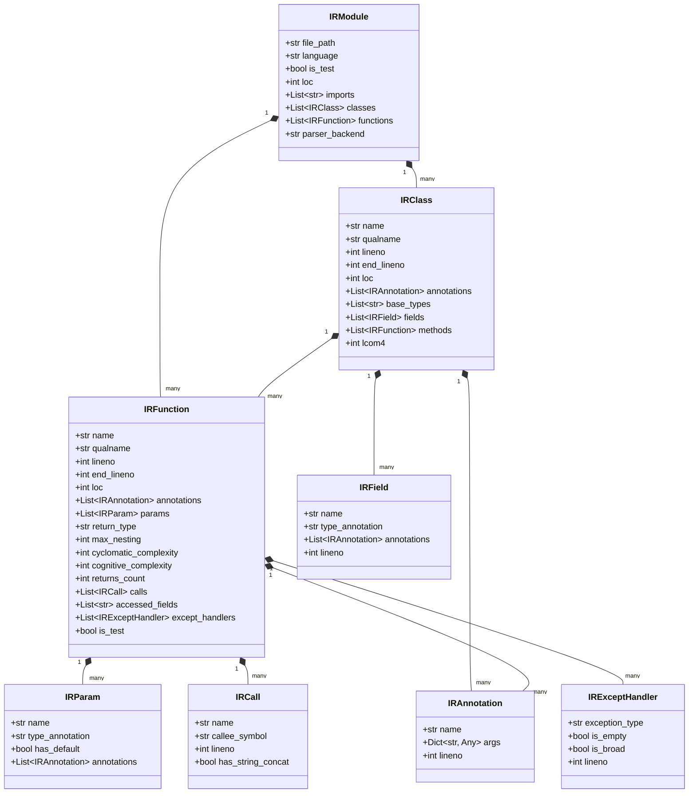

# Data Model: Pluggable Language & Framework Profiles

**Feature**: [spec.md](./spec.md) | **Date**: 2026-11-08

This document defines the language-neutral Intermediate Representation (IR), profile metadata models, and parser guard error models.

---

## 1. Unified Intermediate Representation (IR)

The analyzer decouples source language syntax parsing from metric scoring by transforming language ASTs into a normalized IR hierarchy:

---

## 2. Profile Contracts

### `LanguageProfile`
Encapsulates language-level parsing rules and metric customizations:
- `name: str` (e.g., `"python"`, `"java"`).
- `file_extensions: tuple[str, ...]` (e.g., `(".java",)`).
- `comment_prefixes: tuple[str, ...]` (e.g., `("//", "/*", "*/", "*")`).
- `test_path_patterns: tuple[str, ...]` (e.g., `("src/test/java", "*Test.java", "*Tests.java")`).
- `parse(file_path: Path, rel_path: str, is_test: bool) -> IRModule`.
- `score_clean_code_hooks(func: IRFunction, ctx: AnalysisContext) -> tuple[float, list[str]]`.

### `FrameworkProfile`
Layered architectural rules that plug into a language profile:
- `name: str` (e.g., `"spring-boot"`, `"python-cli-mcp"`).
- `target_language: str` (e.g., `"java"`, `"python"`).
- `concern_map: dict[str, str]` (maps method calls/types to concern buckets).
- `entrypoint_annotations: set[str]` (e.g., `{"GetMapping", "PostMapping", "Bean"}`).
- `lcom4_exempt_annotations: set[str]` (e.g., `{"Entity", "Data", "Configuration"}`).
- `evaluate_function(func: IRFunction, parent_class: IRClass | None) -> list[RulePenalty]`.
- `evaluate_class(cls: IRClass) -> list[RulePenalty]`.

---

## 3. Parser Guard & Error Models

### `MissingNativeParserError`
Raised when a target language requires native grammar packages (`tree-sitter` and `tree-sitter-java`) that are absent from the environment:
- `language: str`: Name of the target language (`"java"`).
- `missing_packages: list[str]`: Packages required (`["tree-sitter", "tree-sitter-java"]`).
- `install_instructions: dict[str, str]`: Exact commands for `uv run`, `uv pip`, and `pip`.
- `message: str`: Formatted explanation for the user.
