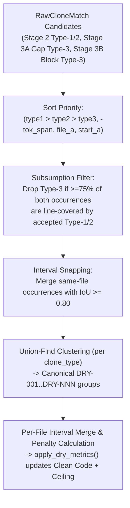

# Data Model: Multi-Language Duplicate Code & DRY Metrics Support

**Date**: 2026-11-22  
**Feature**: `005-dry-metrics-support`  
**Spec**: [spec.md](./spec.md)

---

## 1. Public DRY Report Entities (`dry_models.py`, re-exported via `models.py` & `code_health.py`)

| Entity | Fields & Types | Invariants & Notes |
| :--- | :--- | :--- |
| `CloneLocation` | `file_path: str`, `start_line: int`, `end_line: int`, `symbol: str`, `loc: int`, `token_count: int` | Frozen dataclass. `1 <= start_line <= end_line`; `loc = end_line - start_line + 1` (effective span); `symbol` resolves to enclosing class/function/method `qualname` or `"<module>"`. |
| `CloneGroup` | `group_id: str`, `clone_type: str`, `scope: str`, `similarity: float`, `tokens: int`, `loc: int`, `occurrences: list[CloneLocation]` | Frozen dataclass. `group_id` formatted deterministically as `DRY-001`, `DRY-002`, ...; `clone_type in {"type1", "type2", "type3"}`; `scope in {"intra_file", "cross_file"}`; `similarity == 1.0` for `type1`/`type2` and `dry_type3_similarity <= similarity <= 1.0` for `type3`; `len(occurrences) >= 2`. |
| `FileDryMetrics` | `duplicate_blocks: int = 0`, `duplicated_loc: int = 0`, `duplication_ratio: float = 0.0`, `dry_score: float = 100.0`, `dry_penalty: float = 0.0`, `findings: list[str]` | Frozen dataclass. `0 <= duplicated_loc <= file_loc`; `0.0 <= duplication_ratio <= 100.0`; `dry_score = clamp_score(100.0 - dry_penalty)`; `findings` sorted deterministically by `(start_line, group_id)`. |
| `DrySummary` | `total_loc: int = 0`, `duplicated_loc: int = 0`, `duplication_ratio: float = 0.0`, `dry_score: float = 100.0`, `clone_groups_count: int = 0`, `type1_groups: int = 0`, `type2_groups: int = 0`, `type3_groups: int = 0`, `intra_file_groups: int = 0`, `cross_file_groups: int = 0`, `clone_groups: list[CloneGroup]` | Frozen dataclass. `clone_groups_count == type1_groups + type2_groups + type3_groups == intra_file_groups + cross_file_groups == len(clone_groups)`. `dry_score` is the `max(5, file.loc)`-weighted average of analyzed files' `dry_score` values (`100.0` when empty). |

---

## 2. Compact Internal Stream & Match Entities (`dry_models.py`, `slots=True`)

| Entity | Fields & Types | Memory & Layout Notes |
| :--- | :--- | :--- |
| `PyTokenMeta` | `rel_path: str`, `is_test: bool`, `loc: int`, `block_bounds: tuple[tuple[str, int, int, int], ...]` | Frozen slotted input bundle passed into Python token extraction (`(symbol, start_line, end_line, loc)` bounds). |
| `BlockSpan` | `symbol: str`, `start_tok: int`, `end_tok: int`, `start_line: int`, `end_line: int`, `loc: int`, `stmt_count: int` | Frozen slotted span for each function/method (`0 <= start_tok <= end_tok`). Used by Stage 3B Type-3 matching and Stage 4 symbol attribution. |
| `FileTokenStream` | `file_path: str`, `language: str`, `is_test: bool`, `loc: int`, `exact_ids: array[int]`, `norm_ids: array[int]`, `lines: array[int]`, `tok_kinds: array[int]`, `stmt_starts: array[int]`, `blocks: tuple[BlockSpan, ...]` | Frozen slotted stream (~13 bytes/token across 3 `array('I')` + 1 `array('B')` arrays). `language in {"python", "java", "ecmascript"}`. |
| `RawCloneMatch` | `file_a: int`, `start_a: int`, `end_a: int`, `file_b: int`, `start_b: int`, `end_b: int`, `clone_type: str`, `similarity: float` | Frozen slotted match in token coordinates (`start <= end` exclusive/inclusive normalized consistently; intra-file enforces `end_a <= start_b`). |

### Token Encoding Constants (`dry_tokens.py`)

- `TOK_ID = 1`, `TOK_NUM = 2`, `TOK_STR = 3`, `TOK_BOOL = 4`, `TOK_STMT = 5` (reserved normalized IDs `< 16`; dynamic interned IDs start at `16`).
- `KIND_STRUCT = 0` (`exact_id == norm_id`), `KIND_IDENT = 1` (`norm_id == TOK_ID`), `KIND_LITERAL = 2` (`norm_id in {TOK_NUM, TOK_STR, TOK_BOOL}`).

---

## 3. Extended Core Entities (`models.py`, `ir_models.py`)

### `RubricConfig` Extensions (`models.py`)

| Field | Default | Purpose |
| :--- | :---: | :--- |
| `dry_min_tokens` | `35` | Minimum executable tokens per clone occurrence in source files. |
| `dry_min_lines` | `5` | Minimum line span per clone occurrence in source files. |
| `dry_min_tokens_test` | `55` | Relaxed minimum executable tokens for self-contained test files. |
| `dry_min_lines_test` | `8` | Relaxed minimum line span for test files. |
| `dry_type3_similarity` | `0.70` | Minimum Type-3 structural similarity threshold (`0.0–1.0`). |
| `dry_max_gap_tokens` | `12` | Maximum non-matching token gap bridged in Stage 3A gap-stitching. |
| `dry_max_ideal_pct_src` | `10.0` | Excess duplication density threshold (%) for source files. |
| `dry_max_ideal_pct_test` | `15.0` | Excess duplication density threshold (%) for test files. |
| `dry_max_penalty_src` | `35.0` | Maximum Clean Code DRY deduction for source files. |
| `dry_max_penalty_test` | `25.0` | Maximum Clean Code DRY deduction for test files. |
| `dry_exclude_globs` | `()` | Custom POSIX path glob exclusions (JSON/TOML lists coerced to `tuple[str, ...]`). |

### `FileReport`, `CodebaseHealthReport`, & `IRModule` Extensions

- **`FileReport` (`models.py`):** appends `duplicated_loc: int = 0`, `duplication_ratio: float = 0.0`, `dry_score: float = 100.0` (preserving all existing positional slots).
- **`CodebaseHealthReport` (`models.py`):** appends `dry: DrySummary = field(default_factory=DrySummary)`.
- **`IRModule` (`ir_models.py`):** appends `token_stream: Any = None` (consumed and cleared to `None` immediately after scoring so IR reports remain lightweight).

---

## 4. State Transitions, Subsumption & Scoring Rules

- **Per-Occurrence Penalties:** `type1 = 5.0 pts`, `type2 = 4.0 pts`, `type3 = 3.0 pts`.
  - For an **intra-file** group with $k$ occurrences in a file: charge $(k - 1) \times \text{weight}$.
  - For a **cross-file** group: charge $1 \times \text{weight}$ to each participating file (plus extra occurrences if the same file participates multiple times).
- **Density Penalty:** $0.5 \times \max(0.0, \text{duplication\_ratio} - \text{ideal\_pct})$, where $\text{ideal\_pct}$ is `10.0` (source) or `15.0` (test).
- **Cap & Dimension Integration:** `dry_penalty = round(min(cap, raw_occ_pen + density_pen), 1)`; `dry_score = clamp_score(100.0 - dry_penalty)`. Applied solely to `Clean Code` via `DimensionScores.from_raw((srp, size, complexity, clean - dry_penalty, security), cfg)`, activating the worst-dimension ceiling (`composite <= min(weighted, clean + 5.0, 79.5)`) whenever `clean < 75.0`.
